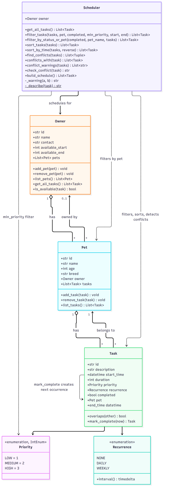

# PawPal+ (Module 2 Project)

You are building **PawPal+**, a Streamlit app that helps a pet owner plan care tasks for their pet.

## Scenario

A busy pet owner needs help staying consistent with pet care. They want an assistant that can:

- Track pet care tasks (walks, feeding, meds, enrichment, grooming, etc.)
- Consider constraints (time available, priority, owner preferences)
- Produce a daily plan and explain why it chose that plan

Your job is to design the system first (UML), then implement the logic in Python, then connect it to the Streamlit UI.

## What you will build

Your final app should:

- Let a user enter basic owner + pet info
- Let a user add/edit tasks (duration + priority at minimum)
- Generate a daily schedule/plan based on constraints and priorities
- Display the plan clearly (and ideally explain the reasoning)
- Include tests for the most important scheduling behaviors

## Getting started

### Setup

```bash
python -m venv .venv
source .venv/bin/activate  # Windows: .venv\Scripts\activate
pip install -r requirements.txt
```

### Suggested workflow

1. Read the scenario carefully and identify requirements and edge cases.
2. Draft a UML diagram (classes, attributes, methods, relationships).
3. Convert UML into Python class stubs (no logic yet).
4. Implement scheduling logic in small increments.
5. Add tests to verify key behaviors.
6. Connect your logic to the Streamlit UI in `app.py`.
7. Refine UML so it matches what you actually built.

## 🖥️ Sample Output

```
Today's Schedule for Chelsea - Tuesday, October 20, 2026
============================================================
07:30-08:00  Morning walk         Buddy      HIGH
08:00-08:15  Breakfast feeding    Whiskers   MEDIUM
14:00-15:00  Vet check-up         Buddy      HIGH
18:30-18:50  Grooming             Whiskers   LOW
```

## 🧪 Testing PawPal+

```bash
# Run the full test suite:
pytest

# Run with coverage:
pytest --cov
```
```
python -m pytest
```
This command checks the following:
- Basics: mark_complete flips a task's status, and add_task adds to the pet's task list.

- Recurrence:
--> Daily and weekly tasks spawn the next occurrence.
--> Completing the same task twice doesn't create a duplicate.
--> Late or early completion lands on the correct next slot.
--> A completion exactly at the next slot skips to the one after.
--> A non-recurring task spawns nothing.
--> The new task copies the old one's fields but gets a fresh id.
--> A task with no pet returns an unattached next task.

- Sorting:
--> Tasks come back in chronological order by full datetime, with ties broken by priority.
--> sort_by_time is stable, can be reversed, and doesn't mutate its input.
--> Empty inputs return empty lists.

- Conflict detection:
--> Same-time tasks are flagged for the same pet and across pets.
--> Back-to-back tasks and completed tasks don't conflict.
--> A contained task counts as a single conflict.
--> Chained overlaps report only the real pairs.
--> check_conflict returns a message or None without raising.

- Availability: build_schedule excludes completed tasks and tasks outside the owner's available hours, and returns the rest in order.

--> A task that crosses midnight is never considered available.
--> A zero-duration task at another task's start time is flagged by conflict_warnings but not by overlaps or check_conflict.

Confidence Level on system's reliability based on test results: 5 stars!

Sample test output:

```
========================= test session starts =========================
platform win32 -- Python 3.13.15, pytest-9.1.1, pluggy-1.7.0
rootdir: C:\Users\kai_1\Coding\codepath\aiEng101\pawpal
plugins: anyio-4.15.1
collected 26 items                                                     

tests\test_pawpal.py ..........................                  [100%]

========================= 26 passed in 0.06s ==========================
```

## 🧩 System Design

The final UML diagram shows how the classes in `pawpal_system.py` fit together. The Mermaid source is in [`diagrams/uml_final.mmd`](diagrams/uml_final.mmd), and the original draft is in [`diagrams/uml.mmd`](diagrams/uml.mmd).



## 📐 Smarter Scheduling

### Implementation summary

The scheduling logic lives in `pawpal_system.py`and is built from four classes plus two enums (`Priority` and `Recurrence`):

- **Owner** holds a list of pets and the hours of the day they're available. `is_available(task)` checks whether a task fits inside those hours, and `get_all_tasks()` gathers every pet's tasks.
- **Pet** holds its own list of tasks. Tasks live only on pets, so there is a single source of truth.
- **Task** has a start time, duration, priority, and recurrence. It knows its `end_time`, whether it `overlaps` another task, and how to `mark_complete()`. Completing a daily or weekly task creates the next occurrence and adds it to the same pet.
- **Scheduler** wraps an `Owner` and does the planning:
  - `filter_tasks` narrows tasks by pet, completion, minimum priority, or time range.
  - `sort_tasks` orders tasks chronologically, with higher priority first on ties.
  - `find_conflicts` finds overlapping pairs across all pets, since the owner can only do one thing at a time.
  - `build_schedule` returns the pending tasks that fit the owner's available hours, in order.

Owner ↔ Pet ↔ Task are linked in both directions. `add_pet` and `add_task` keep both sides in sync and move an item off its previous parent. The classes use identity equality, so two identical-looking tasks or pets are still treated as separate objects.

### Features at a glance

| Feature | Method(s) | How it works |
|---------|-----------|--------------|
| Task sorting | `Scheduler.sort_tasks`, `Scheduler.sort_by_time` | `sort_tasks` sorts on `(start_time, -priority)`: earliest first, higher priority wins ties. `sort_by_time` sorts on start time only; the sort is stable, so ties keep input order, and `reverse=True` gives latest first. Both return a new list and never reorder a pet's own task list. |
| Filtering | `Scheduler.filter_tasks`, `Scheduler.filter_by_status_or_pet` | `filter_tasks` combines pet, completion status, minimum priority and a start/end window; omitted criteria are ignored, and `min_priority` works because `Priority` is an `IntEnum`. `filter_by_status_or_pet` matches the pet by case-insensitive exact name, optionally with status. |
| Owner availability | `Owner.is_available` | Keeps only tasks that start and end inside the owner's daily window. A task that runs past midnight is never available. |
| Schedule building | `Scheduler.build_schedule` | Drops completed tasks, drops tasks outside the owner's available hours, then sorts the rest with `sort_tasks`. The app lists pending tasks left out for falling outside those hours, so nothing disappears silently. |
| Conflict detection | `Task.overlaps`, `Scheduler.find_conflicts` | `overlaps` uses a half-open interval check (`a.start < b.end and b.start < a.end`): back-to-back tasks don't conflict, identical start times do. `find_conflicts` sorts the tasks, then compares each against the ones after it and stops once a later task starts at or after the current one's end, so it does extra work only where tasks actually overlap. It checks across all pets, since the owner can only do one thing at a time. |
| Conflict warnings | `Scheduler.conflict_warnings`, `conflicts_with`, `check_conflict` | `conflict_warnings` covers pending tasks and returns one message per overlapping pair, naming both tasks, their pets and times, and labeled "same pet" or "different pets". `check_conflict` tests one new task against all pending tasks; the app shows its result as a warning after the task is added. Conflicts are reported, never raised, and never block a task. |
| Recurring tasks | `Recurrence.interval`, `Task.mark_complete` | Daily or weekly. Completing a repeating task copies its description, duration, priority and recurrence into a new task with a fresh `id`, attached to the same pet. The next start is the original start plus the interval, repeated until it is after `now`, so a late completion skips ahead but keeps the time of day. Completing an already completed task does nothing, so double-clicks can't create duplicates. |
| Data integrity | `Owner.add_pet`, `Pet.add_task`, `Owner.get_all_tasks` | Tasks live only on pets and are gathered on demand. Both directions of each link stay in sync, and an item is detached from its previous parent. The classes use identity equality, so identical-looking tasks or pets stay separate. |
| Streamlit display | `app.py` | A task table you can filter by pet, status and minimum priority and sort by time, with total, pending and completed counts. One `st.warning` per conflicting pair, or an `st.success` when there are none. A schedule summary showing task count and total minutes. A form that marks a task complete and reports the next occurrence. |

**Caveats**

- `find_conflicts` counts completed tasks too, so filter first if you only want pending ones. `conflict_warnings` already does this.
- A zero-duration task at another task's start time can be flagged by `find_conflicts` depending on sort order, but `overlaps` and `check_conflict` never flag it.

### Sorting

- `Scheduler.sort_tasks(tasks)` orders tasks by start time. When two start at the same time, the higher priority comes first. `build_schedule` uses this.
- `Scheduler.sort_by_time(tasks=None, reverse=False)` orders by start time only. The sort is stable, so ties keep their input order. It defaults to every task across the owner's pets, and `reverse=True` gives latest first.
- Both return a new list and leave each pet's own task list untouched.

### Filtering

- `Scheduler.filter_tasks(...)` narrows tasks by pet object, `completed`, `min_priority`, and a `start`/`end` time range. Any criterion you leave out is ignored.
- `Scheduler.filter_by_status_or_pet(completed=None, pet_name=None)` filters by completion status and/or pet name. The name match is case-insensitive and exact. Giving both narrows to tasks matching both.
- `Owner.is_available(task)` checks that a task falls inside the owner's available hours.
- `Scheduler.build_schedule()` combines these: pending tasks only, within available hours, sorted with `sort_tasks`.

### Conflict detection

The owner can only do one thing at a time, so conflicts are checked across all pets as well as within one pet. Two tasks at exactly the same time count as a conflict. Back-to-back tasks (one ends when the next starts) do not.

- `Task.overlaps(other)` is true when the two time windows overlap.
- `Scheduler.find_conflicts(tasks=None)` sorts the tasks and sweeps once, stopping early for each task once the next one starts after it ends. It returns the overlapping pairs. It counts completed tasks too, so filter first if you only want pending ones.
- `Scheduler.conflict_warnings(tasks=None)` returns one readable message per overlapping pair of pending tasks, labeled "same pet" or "different pets".
- `Scheduler.conflicts_with(task)` lists the pending tasks that overlap one task.
- `Scheduler.check_conflict(task)` returns a warning message for one task, or `None` if it is clear.

This is a lightweight strategy: conflicts are reported as messages and never raise or reject a task. The app shows a warning when you add a clashing task and lists conflicts when you generate the schedule.

### Recurring tasks

- `Recurrence.interval()` gives the gap between occurrences: one day for `DAILY`, one week for `WEEKLY`, and `None` for `NONE`.
- `Task.mark_complete(now=None)` marks the task done. For a recurring task it creates the next occurrence, copying the description, duration, priority and recurrence, and attaches it to the same pet via `Pet.add_task`. It returns the new task, or `None` for a one-off task.
- Calling it again on an already completed task does nothing, so double-clicks can't create duplicates.
- If a task is completed late, the next occurrence skips ahead to the first slot after `now` instead of landing in the past. The next start is computed from the task's original start time, so the schedule keeps its cadence. The optional `now` argument exists so tests don't depend on the clock.

## 📸 Demo Walkthrough

Launch the app with `streamlit run app.py`, or run the command-line demo with `python main.py`.

### Main UI features

The Streamlit page runs top to bottom, and each section builds on the one above it:

- **Owner:** edit the owner's name.
- **Add a Pet:** enter a name, age and breed. The name is required, and an error shows if it's blank. Added pets appear in a table with their task counts.
- **Schedule a Task:** pick a pet, then set a description, date, start time, duration (1-240 minutes), priority (Low, Medium, High) and repeat (None, Daily, Weekly). A success message confirms the task was added. If it overlaps a pending task, a warning appears too, and the task is still added.
- **All Tasks:** see total, pending and completed counts, and a table of every task. Filter by pet, status (All, Pending, Completed) and minimum priority, and sort by time (earliest or latest first) or by time then priority. Below the table, a conflict check shows one warning per overlapping pair, or a success message when there are none. A form marks a task complete and reports the next occurrence when the task repeats.
- **Build Schedule:** click **Generate schedule** to see pending tasks in order within the owner's available hours. It shows a success summary (task count and total minutes), a table, a warning listing any tasks left out for falling outside available hours, and conflict warnings.

### Example workflow

1. **Add a pet.** Under *Add a Pet*, enter "Buddy", age 3, breed "Golden Retriever" and click **Add pet**. Buddy appears in the pets table with 0 tasks.
2. **Schedule a task.** Under *Schedule a Task*, choose Buddy and add "Vet check-up" at 14:00 for 60 minutes, High priority. Then add "Morning walk" at 07:30 for 30 minutes, High priority, repeating Daily. Each shows a success message.
3. **Add a clashing task.** Add "Medication" at 14:00 for 10 minutes. The task is added, and a warning says it overlaps "Vet check-up". PawPal+ warns instead of blocking, so you decide how to resolve it.
4. **Review All Tasks.** The table lists tasks in time order even though they were entered out of order. Try filtering to High priority only, or switching to latest first. The conflict section lists the Vet check-up / Medication overlap.
5. **View today's schedule.** Click **Generate schedule**. Pending tasks appear in chronological order, with the conflict warning repeated beneath the table.
6. **Complete a recurring task.** Mark "Morning walk" complete. It moves to Completed, and a new Daily occurrence is scheduled for the next day at 07:30. Marking it complete again does nothing, so it can't create duplicates.

### Scheduler behaviors shown

- **Sorting:** tasks are entered out of order and displayed chronologically. Tasks that start at the same time are ordered by priority, then by the order they were added.
- **Filtering:** the task table narrows by pet, status and priority, and the schedule excludes completed tasks and tasks outside the owner's available hours.
- **Conflict warnings:** overlapping tasks are flagged across pets as well as within one pet, because the owner can only do one thing at a time. Back-to-back tasks are not flagged.
- **Recurring tasks:** completing a daily or weekly task creates the next occurrence automatically.

### Sample CLI output

`python main.py` builds an owner with two pets and five tasks, added out of order, with one deliberate clash at 14:00. Running it prints the sorted schedule and the conflict warning:

```
Today's Schedule for Chelsea - Tuesday, October 20, 2026
============================================================
07:30-08:00  Morning walk         Buddy      HIGH
08:00-08:15  Breakfast feeding    Whiskers   MEDIUM
14:00-15:00  Vet check-up         Buddy      HIGH
14:00-14:10  Medication           Whiskers   HIGH
18:30-18:50  Grooming             Whiskers   LOW

Conflicts:
  WARNING: 'Vet check-up' (Buddy, 14:00-15:00) overlaps 'Medication' (Whiskers, 14:00-14:10) (different pets)
```
